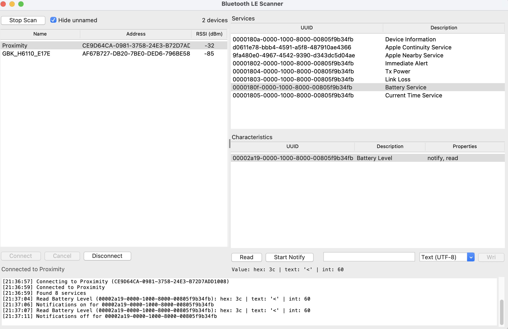

# Bluetooth Scanner (CSCI 323)

A desktop Bluetooth Low Energy (BLE) scanner and GATT explorer written in Python.
It has a tkinter GUI and uses [bleak](https://github.com/hbldh/bleak) for Bluetooth.

**Author:** Jorge Hernandez Umanzor

## Features

- Continuously scans for nearby BLE devices
- Refreshes the device list every 2 seconds, sorted from strongest to weakest signal (RSSI)
- Your selected device stays selected as it moves around the list
- Connect to a selected device (button or double-click), and cancel a connection attempt in progress
- View the device's services, then select a service to view its characteristics and their properties
- Read, write (text or hex), and start/stop notifications on a characteristic
- Disconnect from the device
- Log panel showing every read, write, notification and error; "Hide unnamed" filter for crowded rooms

## How it works

`bleak` is `asyncio`-based while tkinter has its own blocking main loop, so the `asyncio`
event loop runs in a background thread (`AsyncioThread`). Bluetooth callbacks never touch
widgets directly; they post work to a thread-safe queue that the GUI thread drains every
100 ms. Each device row uses the device address as its Treeview item id and is reordered
with `Treeview.move()` instead of being deleted and reinserted, which is what keeps the
selection on the same device as signal strengths change.

## Setup and running

Prerequisites: [VS Code](https://code.visualstudio.com/download), [uv](https://docs.astral.sh/uv/),
and a computer with Bluetooth turned on.

```bash
uv venv .venv --python 3.12
source .venv/bin/activate          # Windows: .venv\Scripts\activate
uv pip install -r requirements.txt
python src/bluetooth_scanner.py
```

On macOS, the first run asks for Bluetooth permission for your terminal or VS Code
(System Settings → Privacy & Security → Bluetooth). On macOS, device addresses are shown as
UUIDs instead of MAC addresses; that is normal for CoreBluetooth.

### Building the documentation

```bash
cd docs
make html                          # Windows: .\make.bat html
```

Output: `docs/_build/html/index.html`

## Usage

1. Scanning starts automatically. Use **Stop Scan / Start Scan** to toggle it.
2. Select a device and click **Connect** (or double-click it). Click **Cancel** to abort the attempt.
3. Select a service to list its characteristics.
4. Select a characteristic. **Read**, **Write** and **Start Notify** are enabled based on its
   properties. The value shows as hex, text (if printable) and an integer.
   Example: the Battery Service `0000180f-...` → Battery Level `00002a19-...` → Read.
5. Click **Disconnect** when done.

## Screenshot



## AI prompt used

The code was generated with Claude (Anthropic) using the prompt below, then reviewed,
corrected, and tested.

> Write a Python script that scans for Bluetooth Low Energy devices, using `bleak` for
> Bluetooth and `tkinter` for the GUI. Requirements:
>
> 1. Have a graphical user interface (GUI)
> 2. Scan for all available Bluetooth devices
> 3. Refresh every 2 seconds
> 4. Sort the devices from strongest signal to weakest signal
> 5. Allow the user to connect to a selected device
> 6. Allow the user to see the device's services
> 7. Allow the user to select a service and see its characteristics
> 8. Allow the user to read/write/notify characteristics
> 9. Allow the user to disconnect from the device
> 10. Allow the user to cancel a connection attempt
> 11. Keep the user's selection selected even as a device moves around the list
>
> Run the asyncio event loop in a background thread so the GUI never freezes, and only update
> tkinter widgets from the main thread. Use NumPy-style docstrings so the code works with
> Sphinx autodoc, and put my name (Jorge Hernandez Umanzor) and the date in the module docstring.

### Review notes (what I checked/fixed)

- Confirmed that the tkinter and asyncio loops are kept on separate threads and that all widget
  updates go through the GUI-thread queue.
- Fixed the cancel button so the GUI resets even if the connection is cancelled before it starts.
- Fixed an incorrect doctest in `format_value` and checked the helper functions with `doctest`.
- Write uses "write with response" when the characteristic supports it, otherwise "write without response".
